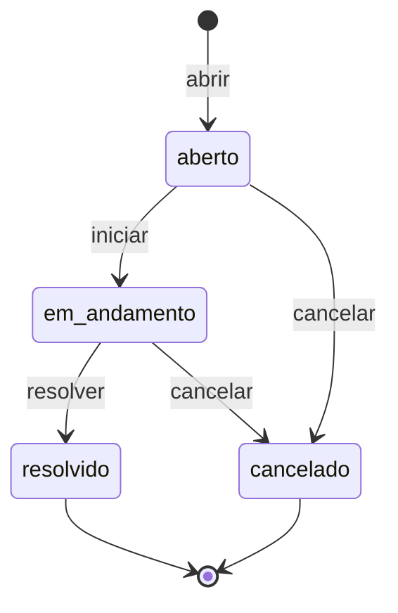

<div align="center">

# Laboratório de Engenharia de Software

Repositório de exercícios e atividades práticas da disciplina de Laboratório de Engenharia de Software — 5º semestre de Análise e Desenvolvimento de Sistemas.


</div>

---

## Sumário

- [Sobre](#sobre)
- [Estrutura do repositório](#estrutura-do-repositório)
- [Exercícios em Java](#exercícios-em-java)
- [HelpDesk Mini (Python)](#helpdesk-mini-python)
- [Como executar](#como-executar)
- [Fluxo de trabalho com Git](#fluxo-de-trabalho-com-git)
- [Autora](#autora)

---

## Sobre

Este repositório reúne as entregas práticas da disciplina, com foco em modelagem orientada a objetos, separação de responsabilidades, regras de negócio e testes automatizados. Os exercícios iniciais exploram associação e composição entre classes em Java; a atividade de reposição evolui para um serviço completo em camadas, com requisitos, modelagem UML e testes em Python.

## Estrutura do repositório

```text
LabEngSoftwareATV/
├── Ex1/                 Biblioteca: Livro, Usuario e Emprestimo
├── Ex2/                 Pedido: Produto e ItemPedido com cálculo de subtotal
├── Ex3/                 Aluno: cálculo de média e teste manual
├── Ex4/                 Pedido: controle de status
├── helpdesk-mini/       Atividade de reposição — serviço de chamados em Python
├── .idea/               Configuração do projeto no IntelliJ IDEA
└── exercicios.iml       Módulo Java do IntelliJ
```

## Exercícios em Java

| Exercício | Tema | Classes | Conceitos trabalhados |
| --- | --- | --- | --- |
| **Ex1** | Empréstimo de livros | `Livro`, `Usuario`, `Emprestimo` | Associação entre classes, coleção de objetos, controle de disponibilidade |
| **Ex2** | Itens de pedido | `Produto`, `ItemPedido` | Composição, cálculo de subtotal por quantidade |
| **Ex3** | Média de aluno | `Aluno`, `AlunoTest` | Encapsulamento de lista, tratamento de lista vazia, verificação de resultado |
| **Ex4** | Status de pedido | `Pedido` | Estado interno com valor inicial e atualização controlada |

Cada pacote possui uma classe `Main` com um cenário de uso demonstrativo.

## HelpDesk Mini (Python)

Atividade de reposição das aulas de 14/09/2026 e 16/09/2026. Implementa o núcleo de controle de chamados do laboratório de informática: abrir, listar, buscar, iniciar, resolver e cancelar chamados, com validação de campos e uma tabela fixa de transições de status.



| Camada | Arquivo | Responsabilidade |
| --- | --- | --- |
| Modelo | `models.py` | Entidade `Chamado`, prioridades e status |
| Erros | `errors.py` | `ValidacaoError`, `ChamadoNaoEncontrado`, `TransicaoInvalida` |
| Repositório | `repository.py` | Armazenamento em memória e geração de id sequencial |
| Serviço | `service.py` | Validação dos campos e regras de transição |

Documentação completa da atividade em [`helpdesk-mini/README.md`](helpdesk-mini/README.md), com requisitos em [`docs/requisitos.md`](helpdesk-mini/docs/requisitos.md) e modelagem em [`docs/modelagem.md`](helpdesk-mini/docs/modelagem.md).

## Como executar

### Exercícios em Java

Pelo IntelliJ IDEA, abra a pasta do repositório e execute a classe `Main` do exercício desejado.

Pelo terminal, a partir da raiz do repositório:

```bash
javac -d out Ex1/*.java
java -cp out Ex1.Main
```

Substitua `Ex1` pelo exercício desejado. No `Ex3`, o teste manual é executado com `java -cp out Ex3.AlunoTest`.

### HelpDesk Mini

```bash
cd helpdesk-mini
python3 -m venv .venv
source .venv/bin/activate        # Windows: .venv\Scripts\activate
pip install -r requirements.txt
pytest
```

Resultado esperado: `10 passed`.

## Fluxo de trabalho com Git

O projeto segue **git flow** como estratégia de branches e **Conventional Commits** como padrão de mensagens.

| Branch | Finalidade |
| --- | --- |
| `Main` | Versões entregues, marcadas com tags (`v1.0.0`) |
| `develop` | Integração das funcionalidades em desenvolvimento |
| `feature/*` | Desenvolvimento isolado de cada etapa, integrada à `develop` |
| `release/*` | Preparação da versão antes da integração na `Main` |

Prefixos utilizados: `feat`, `fix`, `docs`, `test`, `build` e `chore`.

## Autora

**Vivian Oliveira**
Análise e Desenvolvimento de Sistemas — 5º semestre

[](https://github.com/vivianSantos0101)
