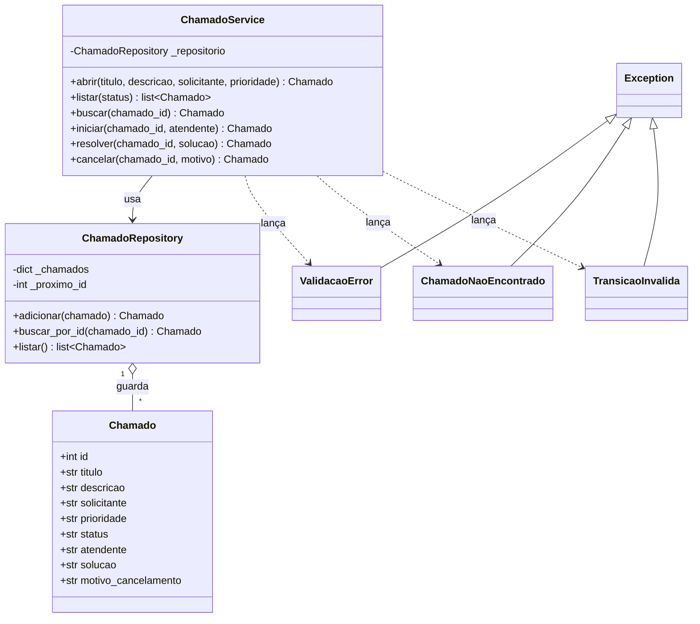

# Modelagem – HelpDesk Mini

## Diagrama de classes

## Tabela de transições

| Status atual | Operação | Status novo | Exige |
| --- | --- | --- | --- |
| `aberto` | iniciar | `em_andamento` | atendente válido |
| `em_andamento` | resolver | `resolvido` | solução válida |
| `aberto` | cancelar | `cancelado` | motivo válido |
| `em_andamento` | cancelar | `cancelado` | motivo válido |

Qualquer outra combinação gera `TransicaoInvalida` e o chamado não muda.
`resolvido` e `cancelado` são estados finais.

## Papel de cada classe

- **Chamado:** entidade que guarda os dados de um pedido de suporte e o seu status atual.
- **ChamadoRepository:** guarda os chamados em memória, gera o id sequencial e permite buscar e listar; não aplica regra de negócio.
- **ChamadoService:** ponto de entrada da aplicação; valida os campos, aplica a tabela de transições e usa o repositório.
- **ValidacaoError:** indica que algum campo informado está fora da regra.
- **ChamadoNaoEncontrado:** indica que o id buscado não existe no repositório.
- **TransicaoInvalida:** indica uma mudança de status que não está na tabela de transições.
